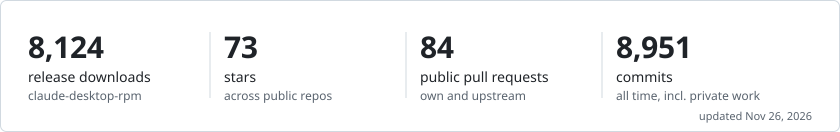

<picture>
  <source media="(prefers-color-scheme: dark)" srcset="assets/metrics-dark.svg" />
  
</picture>

### Open source

<!-- featured:start -->
**[claude-desktop-rpm](https://github.com/ajithakdev/claude-desktop-rpm)** · v1.3.1, Nov 18, 2026 · 67 stars 
Installs Anthropic's official Claude Desktop on Fedora: checksum-verified, no root, updates itself. Fixes dark mode, the tray icon, GNOME search and Cowork (KVM). One Bash script.
<!-- featured:end -->

Also built: [Toolglass](https://toolglass.ajithakdev.com), 41 tools that run entirely in the browser · [MeterX](https://meterx.ajithakdev.com), a speed test in the browser toolbar · [clip-paste](https://github.com/ajithakdev/clip-paste), a clipboard applet for COSMIC in Rust

### Upstream contributions

<!-- upstream:start -->
- [flatpark/flatpark#1562](https://github.com/flatpark/flatpark/pull/1562): feat(claude-desktop): add Cowork as an opt-in through flatpak overrides · merged Nov 26, 2026
<!-- upstream:end -->

### Writing

<!-- writing:start -->
- [Building a Live Terminal Statusline for Claude Code: Tokens, Limits, and Responsive Wrapping](https://media.ajithakdev.com/blog/claude-code-live-terminal-statusline/) · Sep 17, 2026
- [Silent Grouping: How a Missing Field in MongoDB $group Generates Plausible False Positives](https://media.ajithakdev.com/blog/mongodb-group-missing-field-silent-failure/) · Sep 17, 2026
- [Why encodeURIComponent Breaks S3 CopyObject with Silent NoSuchKey Errors](https://media.ajithakdev.com/blog/s3-copyobject-encodeuricomponent-nosuchkey/) · Sep 17, 2026
<!-- writing:end -->

More at [media.ajithakdev.com](https://media.ajithakdev.com).

### Setup

Fedora Workstation with GNOME, daily. Before that: Pop!_OS, Linux Mint and Ubuntu, with Windows since my first PC.

### Contributing

Pick a [good first issue](https://github.com/issues?q=is%3Aopen+is%3Aissue+user%3Aajithakdev+label%3A%22good+first+issue%22) in Toolglass or MeterX, or send a claude-desktop-rpm test report from your distro. I review every pull request.

### Support

These tools are free and will stay that way. If one saved you time, a star helps, and so does a coffee:

<table>
  <tr>
    <td align="center" valign="top" width="280"><b>From anywhere</b>    Card or PayPal on <a href="https://ko-fi.com/ajithakdev">ko-fi.com/ajithakdev</a></td>
    <td align="center" valign="top" width="280"><b>In India, over UPI</b>   <code>ajithakdev@sbi</code> Scan or paste into GPay, PhonePe or any UPI app</td>
  </tr>
</table>
