  

  
  
  
  

  

At work I build backend systems for a healthcare SaaS: an in-house form builder that replaced a paid vendor, fax routing that respects business hours, and DocumentDB pipelines tuned until they stopped timing out. Most of that code is private, so the card above counts my work account too. In my own time I build small tools that run locally and keep your data there.

### Things I've shipped

| | |
|---|---|
| **[toolglass](https://github.com/ajithakdev/toolglass)** 17 developer utilities that never leave your browser: API client, JWT, hashing, cron, JSON to TypeScript, regex. Offline PWA. [Open it](https://toolglass.ajithakdev.com) | **[MeterX](https://github.com/ajithakdev/meterx-server)** A speed test in your browser toolbar, measured against Cloudflare's edge, with a self-hostable server. [Firefox add-on](https://addons.mozilla.org/en-US/firefox/addon/meterx-by-ajithakdev/) |
| **[clip-paste](https://github.com/ajithakdev/clip-paste)** Rust clipboard applet for the COSMIC desktop that pastes the entry you pick into the window you were in. | **[claude-desktop-fedora](https://github.com/ajithakdev/claude-desktop-fedora)** Installs and updates Claude Desktop on Fedora from the official package, checking its signing key and checksums. |
| **[amazon-pincode-checker](https://github.com/ajithakdev/amazon-pincode-checker)** Checks whether an Amazon.in product ships to a list of pincodes. Playwright, CSV or JSON out. | **[CNoBS](https://github.com/ajithakdev/CNoBS)** C in 20-minute chunks. You see the output, guess why, then break it. |

Also live, source private: [minnoli](https://minnoli.vercel.app) puts every Tamil Nadu electricity bill on one screen, and [Auraksha Finds](https://aurakshafinds.ajithakdev.com) is a curated storefront running on Cloudflare's edge.

### Tools I reach for

  

<picture>
  <source media="(prefers-color-scheme: dark)" srcset="assets/snake-dark.svg"/>
  
</picture>
