  

  
  
  
  
  

  

  

### Latest writing

<!-- writing:start -->
- [Building a Live Terminal Statusline for Claude Code: Tokens, Limits, and Responsive Wrapping](https://media.ajithakdev.com/blog/claude-code-live-terminal-statusline/) · Sep 17, 2026
- [Silent Grouping: How a Missing Field in MongoDB $group Generates Plausible False Positives](https://media.ajithakdev.com/blog/mongodb-group-missing-field-silent-failure/) · Sep 17, 2026
- [Why encodeURIComponent Breaks S3 CopyObject with Silent NoSuchKey Errors](https://media.ajithakdev.com/blog/s3-copyobject-encodeuricomponent-nosuchkey/) · Sep 17, 2026
<!-- writing:end -->

More at [media.ajithakdev.com](https://media.ajithakdev.com), write-ups of real production bugs and how they got fixed.

### Contributors wanted

Students welcome. Pick a [good first issue](https://github.com/issues?q=is%3Aopen+is%3Aissue+user%3Aajithakdev+label%3A%22good+first+issue%22) in [Toolglass](https://github.com/ajithakdev/toolglass) or [MeterX](https://github.com/ajithakdev/meterx), or send a [claude-desktop-rpm](https://github.com/ajithakdev/claude-desktop-rpm) test report from your desktop. I review every pull request.

### Support

Everything here is free and stays free. If something saved you time, a star helps. So does a coffee:

<table>
  <tr>
    <td align="center" valign="top" width="280"><b>From anywhere</b>    Card or PayPal on <a href="https://ko-fi.com/ajithakdev">ko-fi.com/ajithakdev</a></td>
    <td align="center" valign="top" width="280"><b>In India, over UPI</b>   <code>ajithakdev@sbi</code> Scan or paste into GPay, PhonePe or any UPI app</td>
  </tr>
</table>
